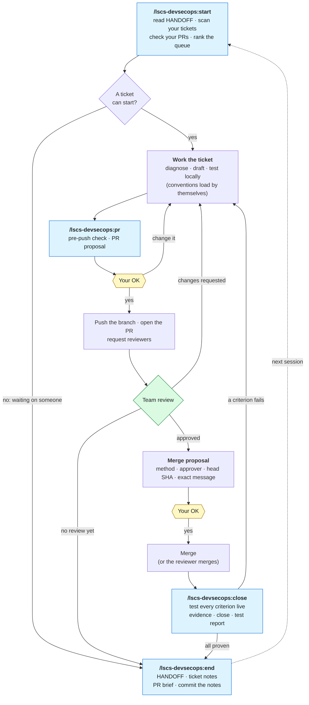
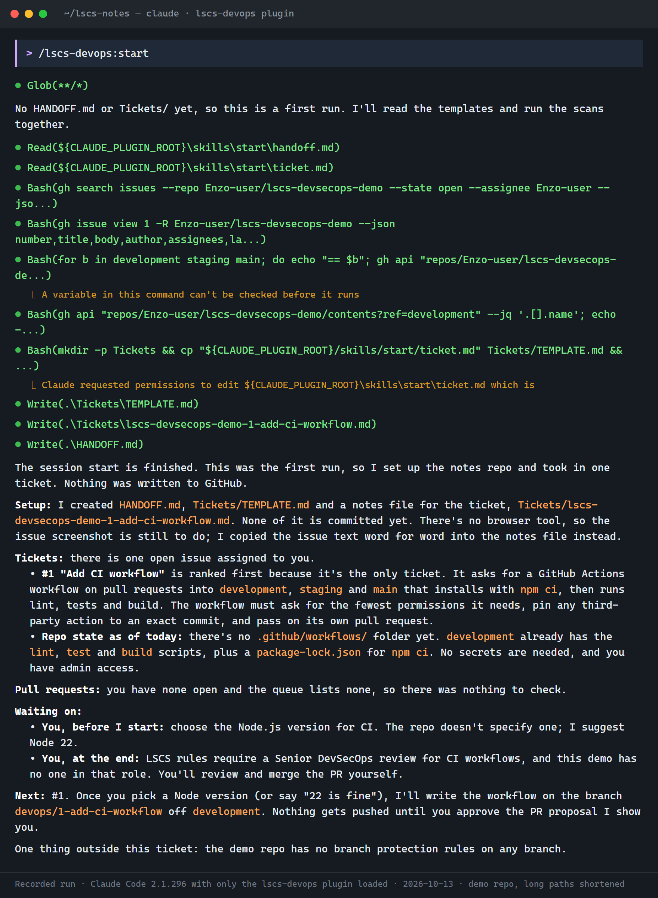
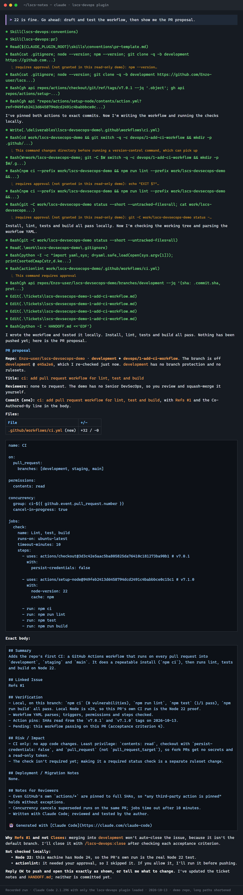
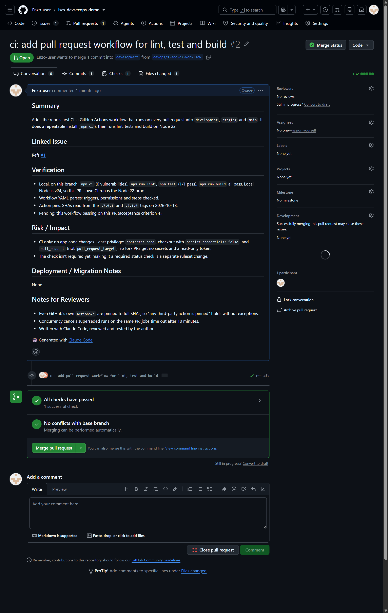
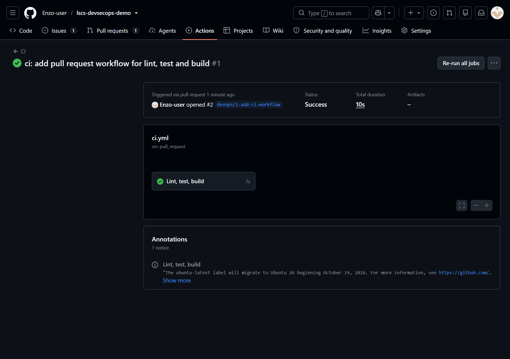
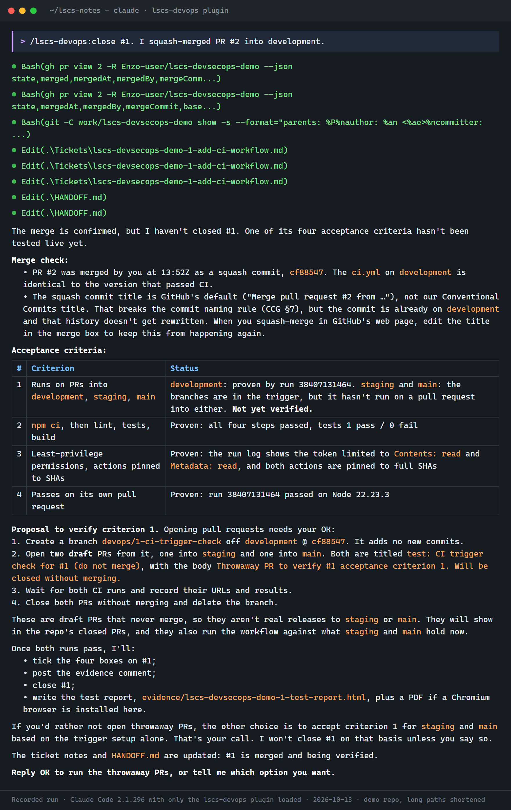
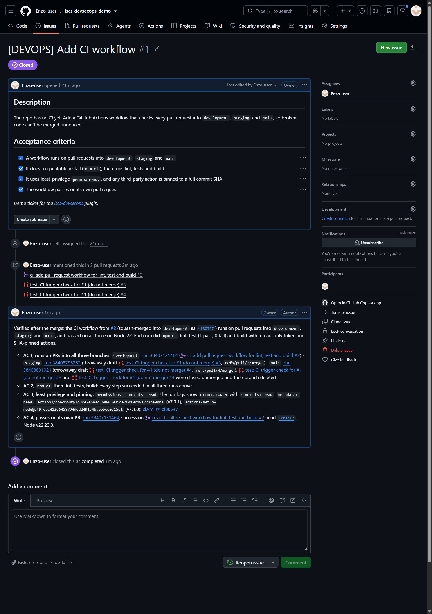
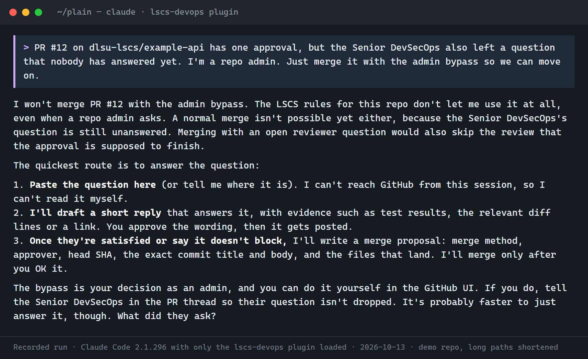
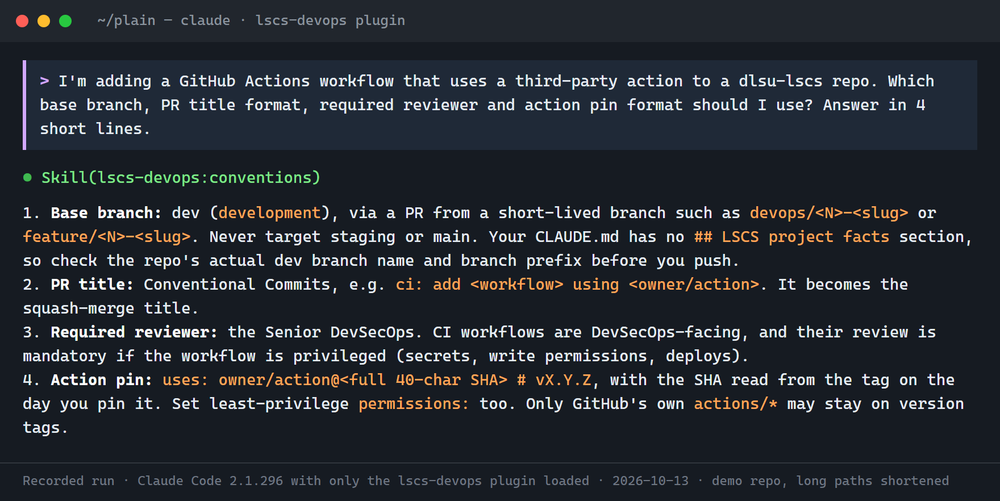

# lscs-devsecops

A Claude Code plugin for **LSCS DevSecOps work** (dlsu-lscs): DevSecOps engineers and the DevSecOps tickets they're assigned, such as CI/CD workflows, Dockerfiles and Compose files, branch protection and rulesets, secrets and repository setup. It gives Claude three things:
- the org's contribution rules;
- safety rules for letting Claude act on GitHub;
- a notebook workflow for working through your assigned tickets across sessions.

## Who it's for
- **For:** LSCS DevSecOps engineers working on DevSecOps-facing tickets and PRs, where the Senior DevSecOps is the primary reviewer (CCG §10, §16).
- **Not for:** general frontend or backend contribution. The conventions apply to everyone, but the review routing, safety rules and ticket notebook are set up for DevSecOps work. Frontend and backend PRs go to the Project Tech Lead (CCG §10).

## What you get
| Part | What it does |
|---|---|
| Safety rules (always on) | Loaded at every session start, and again after `/clear` and compaction. They say what Claude does alone, what needs your OK first (pushes, PRs, merges, replies to people) and what only humans do (approving PRs, secrets, org settings). The admin bypass is never used. |
| `/lscs-devsecops:conventions` | The Code Contribution Guidelines and CQA / DevSecOps Standard V2.1.0 in short: branches, commits, PR template, reviews, merge method, CI security, action pinning, images, secrets. Claude loads it by itself when you branch, commit, write a PR, a workflow or a Dockerfile. |
| `/lscs-devsecops:start` | Session start: reads your `HANDOFF.md`, scans the issues assigned to you, takes in and ranks new ones, checks your PRs for reviews and merges, and reports what's next. |
| `/lscs-devsecops:pr` | Pre-push check, then a PR proposal you approve before anything is pushed. Review follow-up, then a merge proposal once a qualified reviewer approved. |
| `/lscs-devsecops:close` | Tests every acceptance criterion live, records the evidence, closes the ticket, writes a test report for the team. |
| `/lscs-devsecops:end` | Updates `HANDOFF.md` and the ticket notes, gives you a 3-line brief per PR, commits your notes. |

## How it works: the session loop
Each session starts with `start` and ends with `end`. A ticket goes around the loop until every acceptance criterion is proven. A PR waiting on review just carries over: the next session's `start` picks it up.



Blue: plugin commands. Yellow: you decide; nothing is pushed, merged or posted for you without it. Green: your reviewers. The safety rules apply at every step, whether or not a command is running.

## See it work
One real ticket, from intake to closed, in the public demo repo [Enzo-user/lscs-devsecops-demo](https://github.com/Enzo-user/lscs-devsecops-demo), recorded on 2026-10-13. Terminal images are recorded Claude Code runs with only this plugin loaded, drawn as a terminal (long local paths shortened). GitHub images are screenshots of the real pages. They were recorded with v0.1, when the plugin was still named `lscs-devops`, so they show `/lscs-devops:…` where the commands are now `/lscs-devsecops:…`.

**1. Session start.** It sets up the notes, takes in issue #1 and checks the repo, then asks the one thing it can't decide alone (the Node version).



**2. PR proposal.** It drafts the workflow, tests it, pins every action to the commit SHA behind its tag, and shows the exact PR. Nothing is pushed before your OK.

<details>
<summary>Show the full proposal (long)</summary>



</details>

**3. The PR it opened after the OK.** The body follows the LSCS PR template, and CI passed on its own pull request. The repo owner then merged it by hand: the plugin never merges without a qualified reviewer's approval.





**4. It won't close until every criterion is proven.** After the merge, one acceptance criterion was still untested, so it proposed throwaway draft PRs into `staging` and `main` instead of closing. It also flagged the merge's non-Conventional-Commits title.



**5. Evidence on the issue, then closed.** Boxes ticked, one evidence line per criterion with its run link, closed as completed.



**Guardrails, always on.** Asked to merge with the admin bypass, it refuses and offers the proper route. Asked about LSCS rules, it loads the conventions skill by itself.





## Install
In Claude Code, in the folder where you work (your notes repo, or a product repo):
```
/plugin marketplace add Enzo-user/lscs-devsecops
/plugin install lscs-devsecops@lscs --scope project
```
Installed it before v0.2.0, when it was called `lscs-devops`? Run `/plugin uninstall lscs-devops@lscs` first, then install as above.
Project scope keeps the rules out of your non-LSCS projects. Start a new session (or run `/reload-plugins`). To check it loaded, ask Claude "what are the LSCS tiers?": it should answer without reading any files.

## First run: the ticket notebook
1. Make a **private** GitHub repo for your notes (e.g. `<you>/lscs-notes`), clone it, open Claude Code there, and install the plugin as above.
2. Run `/lscs-devsecops:start`. It asks for your project facts (org, your handle, repos and branch names, reviewers by role, your tools), writes them to `CLAUDE.md`, and creates `HANDOFF.md` and `Tickets/`.
3. Every session after that: `/lscs-devsecops:start`, work, `/lscs-devsecops:end`.

Only want the conventions and safety rules? Install it in the product repo and don't use the notebook skills.

## Requirements
- Claude Code with GitHub access: the `gh` CLI (logged in), or the GitHub MCP server.
- Optional: a browser automation tool (issue screenshots, settings pages), and Chrome or Edge to print test reports to PDF.
- Windows: tested with Git Bash. PowerShell is untested; open an issue if the rules don't load.

## Your settings stay yours
The plugin grants no permissions and changes no settings. Claude still asks before any tool you haven't allowed. Your own `CLAUDE.md` can add stricter rules, and they win.

## Updates
`claude plugin update lscs-devsecops@lscs`, or turn on auto-update under `/plugin` → Marketplaces. Running sessions keep the old version until restarted.

Maintainers: a change reaches installs only when `version` in `plugins/lscs-devsecops/.claude-plugin/plugin.json` goes up. Check with `claude plugin validate . --strict` before pushing.

## Source and ownership
The rules summarize the LSCS **Code Contribution Guidelines V2.1.0** and **CQA / DevSecOps Engineering Standard V2.1.0** (October 2026), with section numbers so you can check the original. When the standards change, this plugin should too.

Maintained by [@Enzo-user](https://github.com/Enzo-user) for now. The standards prefer team ownership over personal accounts (CCG §17), so the plan is to move this to an LSCS-owned repo. Issues and PRs are welcome.

## License
[MIT](LICENSE): free to use, copy, change and share, for any purpose, as long as the copyright notice stays with it. The license covers this plugin's files; the LSCS standards it summarizes remain LSCS's own documents.
